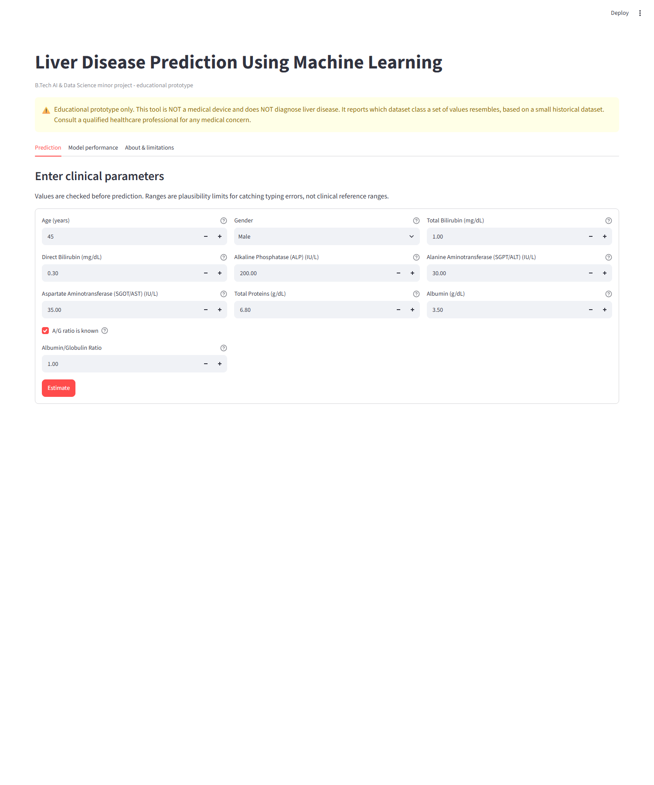

# Liver Disease Prediction Using Machine Learning

An educational machine-learning project demonstrating data preparation, model comparison, probability calibration, and a Streamlit interface using the Indian Liver Patient Dataset (ILPD).

> [!IMPORTANT]
> **Educational use only.** This project is not a medical device and does not diagnose, screen for, or rule out liver disease. Its output reflects patterns in a small historical dataset and must not be used to make healthcare decisions. Consult a qualified healthcare professional about medical concerns.

## Project overview

The training program prepares the data, compares four classification algorithms, selects a candidate using cross-validation, calibrates its probabilities, evaluates the selected model on a held-out test set, and saves the complete pipeline. The Streamlit app loads that pipeline, validates user-entered values, and displays the model's estimated probabilities for the dataset's two classes.

The included dataset has 583 records and ten input features. The original ILPD labels are mapped as follows:

| Project label | Meaning in the source dataset |
|---|---|
| `1` | Liver-patient class (original label `1`) |
| `0` | Non-liver-patient class (original label `2`) |

These are dataset labels, not clinical diagnoses.

## App preview

The screenshot below shows the input form with example defaults before a prediction is submitted. It contains no real person's measurements or prediction result.



## Example evaluation

In the current seeded 80/20 split, the selected calibrated SVM produced the following held-out test results (114 records):

| Metric | Result | Bootstrap 95% interval, when calculated |
|---|---:|---:|
| ROC-AUC | 0.815 | 0.732–0.888 |
| Recall / sensitivity (liver-patient class) | 0.926 | 0.864–0.978 |
| Precision (liver-patient class) | 0.750 | 0.660–0.833 |
| Specificity (non-liver-patient class) | 0.242 | Not calculated |
| Accuracy | 0.728 | Not calculated |

These are results from one small held-out split, not independent validation or evidence of clinical performance. In particular, the low specificity means many non-liver-patient records were incorrectly classified as liver-patient records at the default threshold. Do not interpret these values as medical performance claims. See the [model card](docs/MODEL_CARD.md) for the evaluation setup and limitations.

## Features

- Compares Logistic Regression, Decision Tree, Random Forest, and RBF-kernel Support Vector Machine (SVM) classifiers.
- Tunes model parameters with stratified cross-validation on the training split.
- Keeps preprocessing inside the scikit-learn pipeline to help prevent information from the test split leaking into training.
- Handles missing values, transforms selected skewed laboratory values, scales numeric inputs, and encodes gender.
- Validates app inputs, including plausible value ranges and selected cross-field checks.
- Calibrates the selected model's probabilities and reports the held-out test metrics with bootstrap confidence intervals.
- Generates data summaries, comparison tables, evaluation reports, and plots.
- Includes unit tests that run without the ILPD data or a previously trained model.

## Technologies

| Technology | Use |
|---|---|
| Python | Project language |
| Streamlit | Interactive web interface |
| scikit-learn | Data preprocessing, model training, tuning, calibration, and evaluation |
| pandas and NumPy | Tabular data and numerical operations |
| Matplotlib and Seaborn | Evaluation visualizations |
| Joblib | Saving and loading the trained model |
| `unittest` | Automated tests |

## Repository structure

```text
.
├── app.py                       # Streamlit interface
├── train_model.py               # Data preparation, model selection, evaluation, and saving
├── requirements.txt             # Python dependencies
├── data/
│   └── indian_liver_patient.csv # Included ILPD dataset
├── src/
│   ├── config.py                # Shared paths, feature definitions, and input rules
│   ├── preprocessing.py         # Dataset loading and preprocessing pipeline
│   ├── evaluation.py            # Metrics, confidence intervals, and plots
│   └── prediction.py            # Model loading, input validation, and predictions
├── tests/
│   ├── test_preprocessing.py    # Dataset and preprocessing tests
│   └── test_prediction.py       # Validation and prediction tests
└── docs/
    ├── MODEL_CARD.md            # Intended use, evaluation, and limitations
    └── images/
        └── prediction-app.png   # App preview shown above
```

Training creates `models/` and `outputs/` locally. These generated artifacts are ignored by Git.

## Requirements

- Python 3.10 or later
- pip
- The dataset at `data/indian_liver_patient.csv` (included in this repository)

## Installation

From the repository root, create and activate a virtual environment, then install the dependencies:

```powershell
python -m venv .venv
.venv\Scripts\Activate.ps1
python -m pip install --upgrade pip
pip install -r requirements.txt
```

If PowerShell prevents environment activation, either use Command Prompt:

```bat
.venv\Scripts\activate.bat
```

or follow your organization's guidance for enabling PowerShell scripts. On macOS or Linux, activate the environment with:

```bash
source .venv/bin/activate
```

## Usage

### 1. Train and evaluate the model

```bash
python train_model.py
```

The script uses the included CSV by default. To use a different supported ILPD CSV:

```bash
python train_model.py --data path/to/indian_liver_patient.csv
```

It saves the trained model to `models/liver_model.joblib` and reports to `outputs/`. Reports include:

- `data_summary.json` — record counts, missing values, duplicates, and class distribution
- `metrics.json` — cross-validation results, selected model, held-out test metrics, and confidence intervals
- `model_comparison.csv` — candidate-model cross-validation scores
- `classification_report.txt` and `test_predictions.csv`
- Feature-importance results and generated PNG plots

Model comparisons use training-only cross-validation. The selected, calibrated model is evaluated on the held-out test split. Because the dataset is small and comes from a single source, its results should not be interpreted as evidence of clinical performance.

### 2. Start the web app

Train the model first, then run:

```bash
streamlit run app.py
```

Open the local address printed in the terminal (usually <http://localhost:8501>). Enter the requested values and select **Estimate**. The app checks inputs before using the trained pipeline. The albumin/globulin ratio can be marked unknown and will be imputed by the pipeline.

### 3. Run the tests

```bash
python -m unittest discover -s tests -v
```

## Evaluation approach

The current training workflow removes exact duplicate records, uses a stratified 80/20 train-test split with seed `42`, and performs stratified five-fold grid search on the training split. Candidate models are selected by cross-validated ROC-AUC, with F1 used to break ties. Preprocessing is fitted within each training fold. The selected model is calibrated on training data and evaluated on the held-out test split; bootstrap 95% confidence intervals are included in `outputs/metrics.json`.

## Dataset attribution

The included CSV uses the headerless ILPD format and matches the dataset described by the [UCI Machine Learning Repository](https://archive.ics.uci.edu/dataset/225/ilpd+indian+liver+patient+dataset). UCI lists the dataset under the [Creative Commons Attribution 4.0 International license (CC BY 4.0)](https://creativecommons.org/licenses/by/4.0/). The dataset is attributed to:

> Ramana, B. & Venkateswarlu, N. (2022). *ILPD (Indian Liver Patient Dataset) [Dataset].* UCI Machine Learning Repository. https://doi.org/10.24432/C5D02C.

The loader supports the headerless UCI format and common headered CSV variants. A replacement dataset can be supplied with `--data`. Dataset terms do not license this project's code; no code license is stated here.

## Limitations

- This project is for learning and demonstration, not diagnosis or treatment.
- The dataset is small, class-imbalanced, and from one source population.
- There is no independent external validation, and performance on other populations or clinical settings is unknown.
- Dataset labels and measurements may have limitations that are not addressed by the model.
- The app's probability estimates are not individual clinical risk estimates.

## Future enhancements

- Validate the workflow on a suitably licensed, independent dataset and document population differences.
- Improve the evaluation strategy with nested cross-validation or a separately reserved validation set for model development.
- Add stronger input, model-artifact, and malformed-report tests, plus an automated end-to-end training smoke test.
- Pin and document tested dependency versions for more reproducible installations.
- Improve the app's accessibility, responsive layout, and plain-language explanations of evaluation metrics and uncertainty.
- Add dataset provenance and license notices in a form consistent with the dataset's actual terms.

## Troubleshooting

| Issue | What to try |
|---|---|
| Dataset file not found | Confirm `data/indian_liver_patient.csv` exists, or provide a path with `--data`. |
| Trained model not found | Run `python train_model.py` before starting the app. |
| Dependency or saved-model compatibility error | Activate the intended virtual environment, install `requirements.txt`, and retrain the model. |
| Training takes several minutes | This is expected; grid search, particularly for the Random Forest, can take time. |
